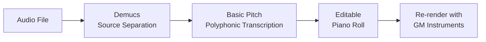

# bunri

> Turn any song into an editable piano roll — locally, privately, open source.

[](LICENSE)
[](https://python.org)
[](#quick-start)

[日本語版はこちら](README.ja.md)


*(demo coming soon)*

## Why bunri?

- **Local** — Runs entirely on your machine. No cloud, no subscription, no data leaves your computer.
- **Open** — Apache-2.0 licensed. Fork it, extend it, ship it.
- **Editable** — Not just stems. Actual MIDI-like notes you can edit, rearrange, and re-render with any instrument.

## Quick Start

bunri is a desktop app for macOS (Apple Silicon). The Python backend and the ML libraries run on your machine; the app sets them up for you.

There is no prebuilt download yet. Build the app yourself:

```bash
# Needs Rust, Node.js 22+ and an internet connection (the build downloads the `uv` binary it bundles)
npm ci
npm --prefix web-ui ci
npm run tauri build
# -> src-tauri/target/release/bundle/dmg/bunri_<version>_aarch64.dmg
# -> src-tauri/target/release/bundle/macos/bunri.app
```

**First launch.** The app does not ship Python or the ML libraries (that would be several GB).
On first launch it downloads Python 3.11 and the dependencies (about 1.2 GB) into
`~/Library/Application Support/io.github.suwakei.bunri/` and shows the progress. This takes a few
minutes. If you quit or lose the connection midway, the next launch continues where it stopped.
Later launches take a couple of seconds. The separation models are downloaded the first time
you separate a song; the status line says so.

**Opening an unsigned app.** The app is not signed with an Apple Developer ID and not notarized.
An app you built yourself opens normally. If you received the `.dmg` from someone else, macOS
blocks it the first time:

1. Open the app once (it is blocked), then go to **System Settings > Privacy & Security** and click **Open Anyway**.
2. Or remove the quarantine flag: `xattr -dr com.apple.quarantine /Applications/bunri.app`

**Where your data lives.** Uploads, results and projects are stored in
`~/Library/Application Support/io.github.suwakei.bunri/data/`. Files you export are saved to `~/Downloads`.

**Optional tools.** These are not bundled. Everything else works without them.

- GM instruments (FluidSynth): `brew install fluid-synth`, then put
  [`MuseScore_General.sf3`](https://ftp.osuosl.org/pub/musescore/soundfont/MuseScore_General/) (MIT, 38 MB)
  into a `soundfonts/` folder inside the data folder (`.../io.github.suwakei.bunri/data/soundfonts/`).
  Without it, the built-in synth is used instead.
- MP3 / MP4 conversion: `brew install ffmpeg`

To work on the app, run it in development mode: `make install`, `make install-frontend` and `make install-desktop` once, then `make desktop`.

For development with Codex, run `make harness-setup`; see the [Codex harness guide](docs/codex-harness.md) for shared agent rules, skills and verification commands.

## How It Works



1. **Separate** — Demucs splits your song into 6 stems (vocals, drums, bass, guitar, piano, other)
2. **Transcribe** — Spotify's Basic Pitch detects every note in each stem, including chords
3. **Edit** — Notes appear on a piano roll where you can move, resize, add, or delete them
4. **Re-render** — Play back with your choice of 84 GM instruments, or export as WAV

## Comparison

| Feature | bunri | Moises.ai | RipX DAW | Spleeter GUI | Basic Pitch CLI |
|---|:---:|:---:|:---:|:---:|:---:|
| Open source | Yes | No | No | Yes | Yes |
| Offline / local | Yes | No | Yes | Yes | Yes |
| Stem separation | 6 stems | 5 stems | 6 stems | 4 stems | No |
| Polyphonic transcription | Yes | No | Yes | No | Yes |
| Editable piano roll | Yes | No | Yes | No | No |
| Built-in DAW | Yes | Limited | Yes | No | No |
| Price | Free | $4-25/mo | $200+ | Free | Free |

## Features

- **Song to Piano Roll** — Upload any audio file, get editable notes on a timeline in one click
- **Source Separation** — Demucs 6-stem (vocals / drums / bass / guitar / piano / other)
- **Synth & Drum Machine** — 4 waveforms, 6 instrument presets, GM soundfont, 4 drum patterns
- **Effects** — EQ, compressor, reverb, delay, pitch shift, time stretch
- **WAV Optimizer** — Reduce file size with high-quality resampling + TPDF dithering
- **Project Save/Load/Export** — JSON projects, WAV mixdown export, MIDI export of piano-roll notes

## Roadmap

- [x] Basic Pitch integration (polyphonic transcription)
- [x] Desktop app (macOS, Apple Silicon)
- [x] MIDI export (piano-roll notes to a standard MIDI file)
- [x] MIDI keyboard input (step input and real-time recording)
- [x] MIDI import (as new tracks, or as a reference to practise against)
- [ ] VST plugin support
- [ ] Real-time collaboration
- [ ] Windows / Linux builds

## Development

The audio engine (`src-tauri/audio-engine`) builds [sfizz](https://github.com/sfztools/sfizz) from a git submodule,
so `make test` / `make lint` also need the submodules and CMake:

```bash
git submodule update --init --recursive
brew install cmake
```

```bash
make install           # Backend dependencies (uv sync)
make test              # Run all tests (frontend + backend + Rust)
make lint              # ESLint + ruff + cargo fmt / clippy
cd web-ui && npx tsc --noEmit  # Type check
make desktop           # Desktop app in development mode (npm run tauri dev)
```

See [docs/daw-features.md](docs/daw-features.md) for detailed architecture and API documentation,
and [docs/desktop-architecture.md](docs/desktop-architecture.md) for how the desktop app is put together.

## Contributing

We welcome contributions! Please open an issue first to discuss what you'd like to change.

## License

[Apache-2.0](LICENSE)
